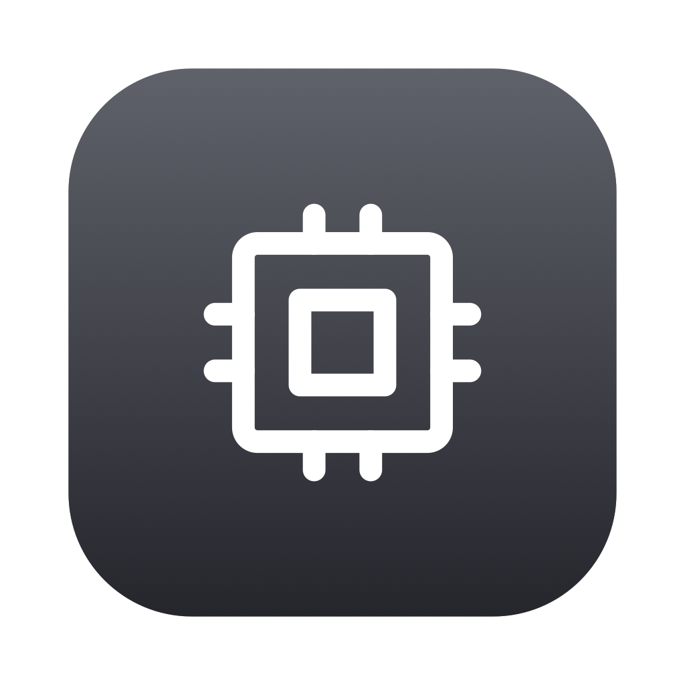
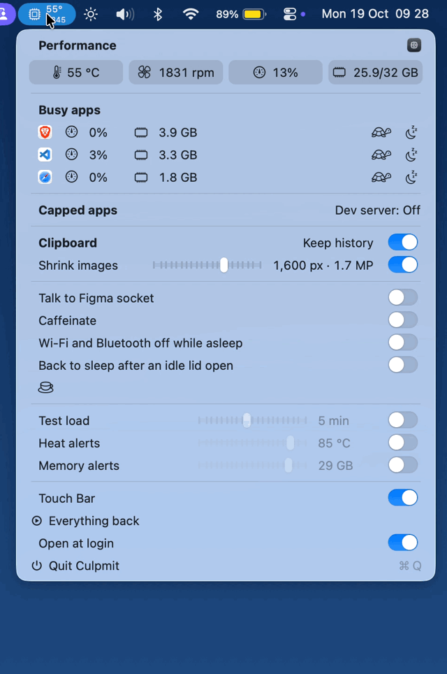
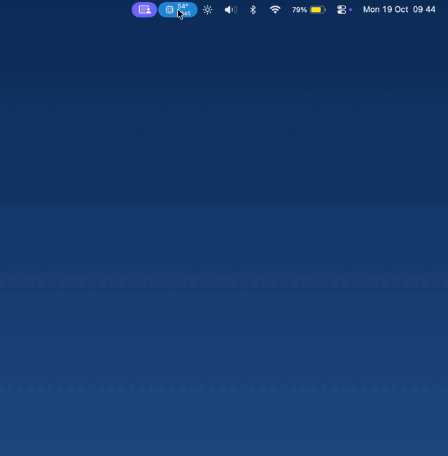
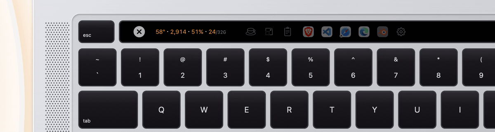

<p align="center"></p>

# Culpmit

**Culprit Limiter** for Intel Macs that run hot.

Culpmit sits in the menu bar with the CPU temperature over the fan speed. When something heats the Mac, it names the app and holds it to a share of the processor, so the fans settle and the work carries on.

<p align="center"></p>

## What it does

- **Readout:** the CPU temperature over the faster fan's speed in the menu bar, live every second; in the menu, temperature, fan, CPU load and memory used side by side. Each figure's box turns orange at its alert's line and red at 90% (90 °C for the temperature), and the Touch Bar's figures take the same colours; the fan turns orange with the temperature and red past 90% of its top speed, and memory also follows macOS's memory pressure.
- **Busy apps:** apps using half a core or more, plus the three holding the most memory, each once with its CPU share and memory, a tortoise to cap it and a moon to idle it, red while on. Up to four show as rows; with five or more, three rows and a + row with the rest. Cap sets a ceiling at half of what the app uses at that moment, so one click slows it. Idle holds an app to a tenth of one core, so it keeps running cool until you wake it.
- **Capped apps:** every app you cap, with every process it starts, held to a share of the Mac from 5% to 80%, beside its memory line: past the line, while memory is short, the app idles so macOS can squeeze its memory, and it wakes when you switch to it or memory eases. The app in front stays live. Its switch lets it run free. Hold Option while opening the menu to add or remove apps.
- **Memory alerts:** when memory used stays past a line you set from 25 to 95% (90% to start), or macOS keeps moving memory to swap, for a minute, a notification names the heaviest app with Idle.
- **CPU alerts:** at a line you set from 25 to 90% of the whole Mac, 80 to start, held for a minute, a notification names the busiest app with Cap and Idle.
- **Red alerts:** a figure at 90% for a minute brings one more alert while its switch is on; with the switch off, it only turns red.
- **Heat alerts:** at a line you set from 50 to 90 °C, 85 to start, held for a minute, a notification names the busiest app with Cap and Idle.
- **Test load:** seven small test apps for one to thirty minutes: six keep every core busy and the seventh fills memory until it runs short, so you can watch Busy apps fill, the Touch Bar light up, the heat and memory alerts arrive and the memory line idle the seventh, and try Cap and Idle on them. Caffeinate, both alerts, Shrink images, Keep history and the Touch Bar stay on for the test and return to where they were after. Switched back on within a minute, the same run carries on.
- **Shrink images:** each screenshot on the clipboard shrinks to an image size you choose, 800 to 2,000 px on its long side, so it pastes light into chats and docs. Smaller crops pass as they are.
- **Clipboard history:** the last ten items, text and images, held in memory. The item on the clipboard now stays out of the list. Text copied on an iPhone, iPad or another Mac joins it; their images stay on that device until you paste them.

  

- **Sleep:** Caffeinate on demand, letting go on battery below 20%. Wi-Fi and Bluetooth off while the Mac sleeps. On a laptop, back to sleep when the lid opens and the Mac stays idle. A list of the apps keeping the Mac awake.
- **Developers:** every local server listening on the Mac, one click to open; the cap on a `next dev` run through `cpulimit`; a switch for the [Talk to Figma](https://github.com/grab/cursor-talk-to-figma-mcp) socket on port 3055, which needs [bun](https://bun.sh).
- **Touch Bar:** the readout with memory last, the switches, the clipboard, and one row of apps: capped and idled apps lit, busy uncapped apps dim, each group a swipe away. A tap does the item's action: a switch flips, a clip copies, an app is capped or freed. A hold opens its details: the readout with units, a switch by name with On and Off, a clip's first line or a larger image, an app's use beside its CPU cap and memory line; VoiceOver reaches them as each item's Details action. ⌃⌥⌘C opens the strip from anywhere.

  

- **Everything off:** one click in the menu turns every switch and cap off and wakes idled apps; Everything back turns on what was on.

## Requirements

- An Intel Mac with macOS 13 Ventura or later. Apple silicon support comes in a later version.
- The Touch Bar strip appears on MacBook Pros with a Touch Bar.

## Install

### Download

1. Download the latest `Culpmit-x.y.z.zip` from [Releases](https://github.com/booban1/culpmit/releases/latest).
2. Unzip it and drag Culpmit into Applications.
3. Open Culpmit. macOS asks once to confirm an app from outside the App Store: open System Settings › Privacy & Security and click **Open Anyway**.

### curl

```sh
curl -fsSL https://raw.githubusercontent.com/booban1/culpmit/main/install.sh | bash
```

### Homebrew

```sh
brew tap booban1/culpmit https://github.com/booban1/culpmit
brew install --cask culpmit
```

The first open asks for the same one-time confirmation as a download.

### npx

```sh
npx github:booban1/culpmit
```

## First run

Culpmit opens at login and comes back on its own after a crash, with Open at login in its menu to change both; macOS lists it under Login Items, Allow in the Background. Allow notifications when macOS asks, for heat alerts and updates. The first time Culpmit turns Bluetooth off for sleep, macOS asks for Bluetooth access.

## Privacy

- Clipboard history lives in memory and clears when Culpmit quits.
- The one network call is the update check to GitHub releases.
- Settings live in `~/Library/Preferences/com.simonbooban.culpmit.plist` and the log in `~/Library/Logs/Culpmit.log`.

## Removing Culpmit

Switch Open at login off in its menu, quit it, and move it from Applications to the Trash. Already in the Trash? Delete `~/Library/LaunchAgents/com.simonbooban.culpmit.plist` too. With Homebrew: `brew uninstall --cask culpmit`, which does both.

## Licence

MIT, see [LICENSE](LICENSE). The chip in the app icon comes from [Tabler Icons](https://tabler.io/icons), also MIT.
